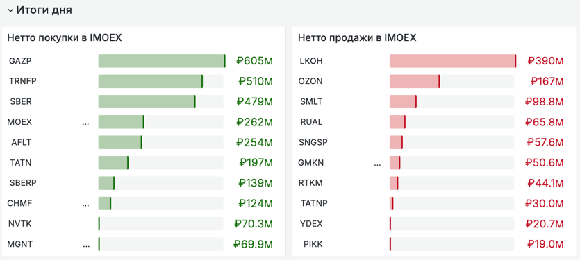
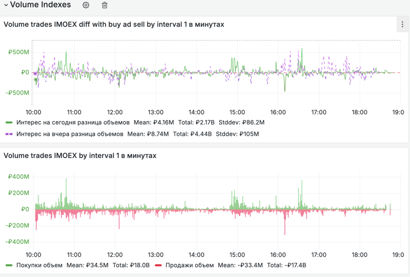

# Transaq Clickhouse Exporter

## Description

gRPC клиент от [txmlconnector`а](https://github.com/kmlebedev/txmlconnector) для экспорта данных торгов ММВБ в базу данных [ClickHouse](https://clickhouse.com/)

## Переподключение

Переподключением управляет `txmlconnector`:

- exporter завершает текущую сессию при статусе терминала `connected=false`/`connected=error`, закрытии gRPC response stream или ошибке восстановления подписок;
- `txmlconnector.RunWithReconnect` закрывает старый `TCClient` и создаёт новый с экспоненциальной задержкой от 1 до 30 секунд;
- после статуса `connected=true` exporter заново формирует и отправляет подписки без накопления дубликатов.

Параметры переподключения централизованы в `txmlconnector.DefaultReconnectConfig`; отдельная переменная `TC_RECONNECT_INTERVAL` exporter больше не используется.

Входящие сделки, котировки и обновления инструментов дренируются независимо от восстановления подписок и записи в ClickHouse. Сделки и котировки записываются пакетами. Если ClickHouse длительно не успевает обрабатывать поток, экспортёр выводит предупреждение `TRANSAQ ... queue reached ... events`; это означает, что нужно проверить задержки и доступность ClickHouse.

## Фильтры экспорта

- `EXPORT_SEC_BOARDS` — режимы торгов, по умолчанию `TQBR,TQTF,FUT`; для ОФЗ добавьте `TQCB,TQOB`.
- `EXPORT_SEC_CODES=ALL` — подписка на котировки/свечи по всем инструментам выбранных режимов; иначе — список кодов или `ALL`.
- `EXPORT_SEC_INFO_NAMES=ALL` — `get_securities_info` по всем облигациям выбранных режимов; иначе — список суффиксов короткого имени (например, `МТС`).
- `EXPORT_ALL_TRADES=ALL` — подписка на сделки по всем инструментам выбранных режимов; иначе — `positions` и/или список кодов.

Пример сбора ОФЗ: `EXPORT_SEC_BOARDS=TQCB,TQOB EXPORT_SEC_CODES=ALL EXPORT_SEC_INFO_NAMES=ALL EXPORT_ALL_TRADES=ALL`.

Команда `get_securities_info` отправляется в документированном формате `<security><market>…</market><seccode>…</seccode></security>`. Наличие `sec_info`, котировок и сделок зависит от подписки брокерского счёта: команда может вернуть `success=true`, не прислав рыночные данные.
