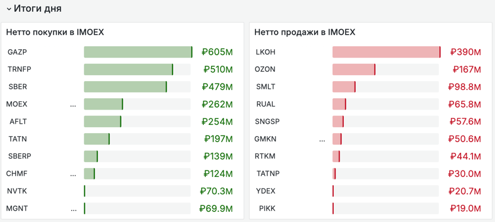
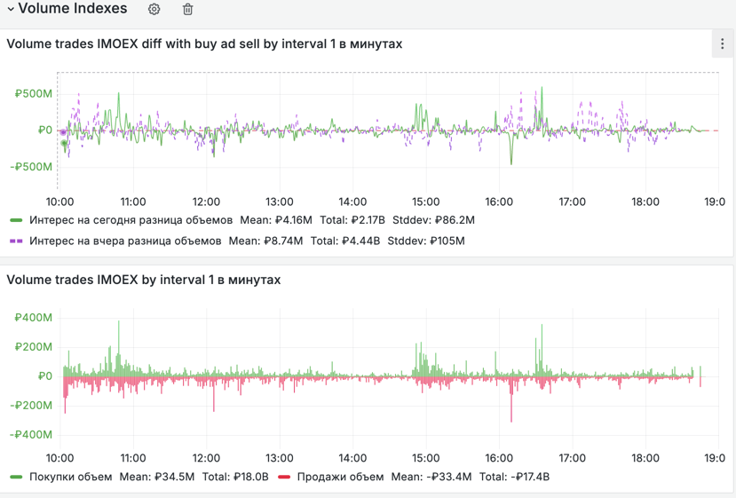

# Transaq Clickhouse Exporter




## Description

Экспорт данных торгов ММВБ из TRANSAQ в [ClickHouse](https://clickhouse.com/).
По умолчанию используется **native-клиент** `txmlconnector/native` — прямое TCP-подключение
к серверу TRANSAQ без DLL и без gRPC-прокси. Прежний gRPC-клиент
`txmlconnector-server` сохранён для обратной совместимости и включается переменной
`TRANSAQ_BACKEND=grpc`.

## Провайдеры данных

| `TRANSAQ_BACKEND` | Источник | Что нужно |
|---|---|---|
| `native` (по умолчанию) | `native.Client` из `txmlconnector` | `TC_LOGIN`, `TC_PASSWORD`, `TC_HOST`, `TC_PORT`; прямой TCP до TRANSAQ |
| `grpc` | legacy `txmlconnector-server` | те же `TC_*` + `TC_TARGET` (по умолчанию `localhost:50051`) и запущенный сервер |

Выбор сделан через общий Go-интерфейс `Provider`/`Session` (`provider.go`): ядро экспортёра
не знает о транспорте, а источник подключается фабрикой из реестра `RegisterProvider`.
Опциональные возможности (`CatalogSource`, `Subscriber`, `SecuritiesInfoSource`,
`HistorySource`, `PositionSource`) проверяются через type assertion, поэтому будущий
потребитель NATS сможет отдавать только поток событий без каталога и подписки.

## Переподключение

Переподключением управляет супервизор `runExporter`:

- native-клиент сам восстанавливает короткий обрыв внутри `Run` (`server_status` с
  `recover`, затем `connected`); при исчерпании `session_timeout` сессия закрывается и
  провайдер открывается заново;
- gRPC-провайдер завершает сессию при `connected=false`/`connected=error`, закрытии response
  stream или ошибке восстановления подписок;
- провайдер переоткрывается с экспоненциальной задержкой 1 → 30 секунд; после стабильной
  сессии (минута) задержка сбрасывается;
- после открытия сессии экспортёр заново строит подписку по каталогу, без накопления дублей.

Входящие сделки, котировки и обновления инструментов дренируются независимо от восстановления
подписок и записи в ClickHouse. Сделки пишутся батчами (до 1000 строк или раз в 500 мс), в том
числе при штатной остановке сессии. Если ClickHouse длительно не успевает обрабатывать поток,
экспортёр выводит предупреждение `TRANSAQ ... queue reached ... events`.

## Каталог инструментов и подписка

- **native**: `Dial` завершается после загрузки полного каталога, поэтому подписка строится
  сразу по `Catalog().List()`; `waitQuiet` не нужен.
- **grpc**: каталог приходит несколькими сообщениями `securities`, а `TCClient.Data.Securities`
  хранит только последнее. Провайдер собирает каталог из типизированного потока
  `PortfolioUpdates` с дедупликацией по `secid` и отправляет подписку, когда поток стих
  (5 секунд без новых сообщений, не дольше 2 минут).

Проверки `checkSubscriptions` и `checkSecuritiesInfo` сохраняют защиту от ночного неполного
каталога: пустая подписка или отказ по большинству `sec_info` пересоздают сессию.

## Фильтры экспорта

- `EXPORT_SEC_BOARDS` — режимы торгов, по умолчанию `TQBR,TQCB,FUT`; для ОФЗ добавьте `TQCB,TQOB`.
- `EXPORT_SEC_CODES=ALL` — подписка на котировки/свечи по всем инструментам выбранных режимов; иначе — список кодов или `ALL`.
- `EXPORT_SEC_INFO_NAMES=ALL` — `get_securities_info` по всем облигациям выбранных режимов; иначе — список суффиксов короткого имени (например, `МТС`).
- `EXPORT_ALL_TRADES=ALL` — подписка на сделки по всем инструментам выбранных режимов; иначе — `positions` и/или список кодов.
- `EXPORT_PERIOD_SECONDS` — виды свечей (`period` из `candlekinds`), которые запрашивать.
- `EXPORT_CANDLE_COUNT` — сколько свечей истории запрашивать; `0` — не запрашивать, `<0` — вся история.

Пример сбора ОФЗ: `EXPORT_SEC_BOARDS=TQCB,TQOB EXPORT_SEC_CODES=ALL EXPORT_SEC_INFO_NAMES=ALL EXPORT_ALL_TRADES=ALL`.

## Ограничения native-бэкенда

- Каталог native фиксируется на момент `Dial` (полная загрузка сессии). Инструменты,
  догруженные брокером уже после старта сессии, попадут в `transaq_securities` и подписку
  только при следующем переоткрытии сессии — как и в legacy-пути, который перестраивал план
  на каждой сессии. Лог `TRANSAQ catalog` для native показывает тот же снимок.
- `R_QUOTES` в native-клиенте не восстанавливает `source`/`yield`; при включённых котировках
  эти колонки будут пустыми/0. Полный набор доступен в legacy `TRANSAQ_BACKEND=grpc`.
- `sec_info` рендерится из локального spec-кэша, как это делает DLL: поля вне `RQ_SEC_SPEC`
  (`accruedint`, `put_call`, `opt_type`, `regnumber`, `buyback*`, `bgo_*`) остаются нулевыми.
  Native запрашивает спеки пачками по 50 secid (сервер отдаёт ~100 записей на кадр
  RQ_SEC_SPEC; пачка 200 в живой приёмке вернула только половину); отсутствующие
  спецификации считаются отказами. В legacy gRPC ответы ждутся общим дедлайном: таймаут
  логируется отдельно и не считается отказом команды, поэтому не пересоздаёт сессию.
- `push_u_limits`/`push_pos_equity` в native-клиенте хранятся, но периодические таймеры не
  реализованы: позиции приходят в загрузке и по изменениям.
- Режим `positions` подписывает загруженные позиции в начале сессии и досылает подписку при
  появлении новой позиции.
- Native-клиент сам отбрасывает повторные сделки (дедупликация по `board/seccode/tradeno`);
  счётчик `TRANSAQ native stats: ... duplicates=...` показывает, сколько отброшено.

## Сборка и деплой

```bash
make build        # linux/amd64, CGO_ENABLED=0, GOWORK=off (модуль из go.mod)
make test         # go test -race ./...
make vet
```

`GOWORK=off` обязателен: локальный `go.work` подключает соседнее дерево `../txmlconnector`, а на
стенд должен уходить модуль, прибитый в `go.mod`. Версия `txmlconnector` в `go.mod` — та, где
появился пакет `native/`.

Деплой на staging и откат — `deploy/staging/README.md`.
